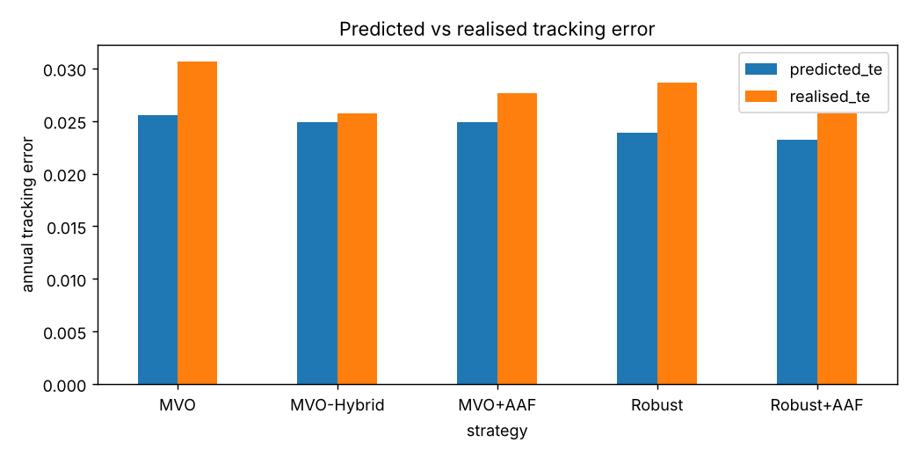
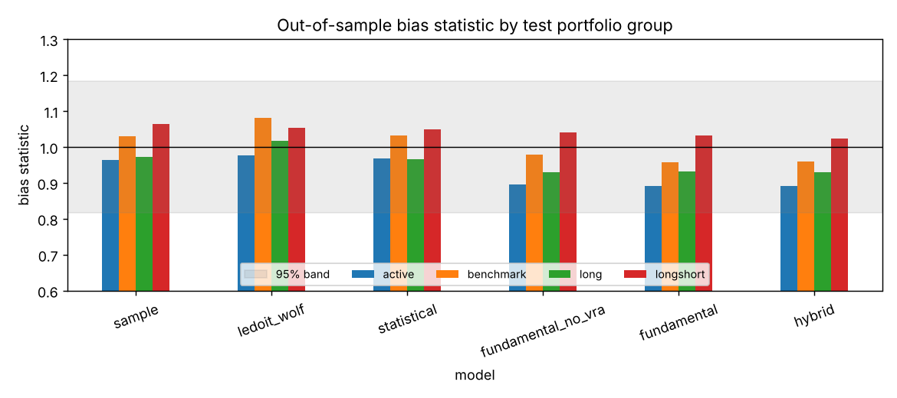

# equity-risk-model

Barra-style fundamental and Axioma-style statistical equity risk models, built from scratch in Python, plus the benchmark-relative optimiser that consumes them: mean-variance with tracking error and exposure limits, robust optimisation over alpha uncertainty, and the alpha alignment factor.

Everything is evaluated out of sample: forecast bias on test portfolios, minimum-variance tests, and a monthly backtest where every strategy sees the same alpha, so differences in realised tracking error come from risk modelling alone.

## What's inside

**Fundamental model (`fundamental.py`, `exposures.py`, `regression.py`)**, following the structure of MSCI Barra's USE4 notes.

- Style factors: beta, momentum, size, residual volatility, liquidity, value, quality, growth. Descriptors are winsorised and standardised to a cap-weighted mean of 0 and an equal-weighted std of 1. Residual volatility is orthogonalised to beta and size, liquidity to size. Missing values get the industry median.
- Factor returns from a daily cross-sectional WLS regression (sqrt cap weights) on country + industry + style exposures. Country and industries are collinear, so industry returns are constrained to a cap-weighted sum of zero.
- Factor covariance: EWMA with an 84-day half-life for volatility and 504 days for correlation, Newey-West with 2 lags, and a volatility regime adjustment that rescales the matrix when recent factor returns ran hot or cold relative to forecasts.
- Specific risk: EWMA of squared residuals, Bayesian shrinkage toward the cap-weighted mean of the stock's size decile, and its own regime adjustment.

**Statistical and hybrid models (`statistical.py`)**, in the spirit of Axioma's product line.

- Statistical: asymptotic PCA (Connor and Korajczyk) on a trailing return window, no fundamental data at all.
- Hybrid: the fundamental model plus the top residual principal components as extra factors, which catches risk the descriptors miss.
- Baselines for comparison (`baselines.py`): sample covariance and Ledoit-Wolf shrinkage.

**Optimiser (`optimize.py`)**, solved with cvxpy in factor form.

- Maximise alpha minus risk aversion times active variance minus trading cost, long-only, with caps on weight, tracking error, active style and industry exposure, and turnover.
- Robust term (Ceria and Stubbs): subtract kappa times the norm of Omega^1/2 times active weights, the worst case of alpha over an ellipsoid of plausible errors.
- Alpha alignment factor (Ceria, Saxena and Stubbs): the part of alpha the risk model's factors can't span looks like free return to the optimiser. Its unit-norm direction y is added as one more factor, with variance estimated from how much the model's residual returns actually move along y.

**Around it**: Grinold alpha scaling (`alpha.py`), ex-post return and ex-ante risk attribution (`attribution.py`), bias-statistic evaluation (`evaluation.py`), and the backtest (`backtest.py`).

## Data

There are two paths.

- **Simulated (default).** 300 stocks over 8 years, with a market factor under stochastic volatility and a calm/stress regime, industry factors, style factors driven by observable characteristics, heteroskedastic specific returns, and one **hidden factor** that no descriptor measures. Each stock has a slowly moving true alpha, partly aligned with its hidden-factor loading, and a noisy signal of it is published monthly. Because the truth is known, every claim below can be checked.
- **Real.** `erm/data/real.py` builds the same `Universe` from yfinance prices and volumes plus an optional long-format fundamentals CSV (date, ticker, book_to_price, earnings_yield, roe, sales_growth), applied with a reporting lag. Use the S&P 500 or your own ticker list, including NSE names with the `.NS` suffix.

## Results (simulated, 59 out-of-sample months)

Full tables and figures are in [`results/sim/summary.md`](results/sim/summary.md).

### Optimiser backtest

Top-100 cap-weighted benchmark, monthly rebalance, 10 bp costs, same alpha for every strategy.

| strategy | active return | realised TE | predicted TE | realised / predicted | IR | turnover | abs hidden exposure |
|---|---|---|---|---|---|---|---|
| MVO | 3.24% | 3.07% | 2.56% | 1.20 | 1.06 | 26.3% | 0.224 |
| MVO-Hybrid | 3.54% | 2.57% | 2.49% | 1.03 | 1.38 | 27.9% | 0.045 |
| MVO+AAF | 2.78% | 2.77% | 2.49% | 1.11 | 1.00 | 21.2% | 0.200 |
| Robust (kappa=1) | 3.04% | 2.87% | 2.39% | 1.20 | 1.06 | 24.6% | 0.208 |
| Robust+AAF | 2.54% | 2.57% | 2.32% | 1.11 | 0.99 | 19.8% | 0.184 |



What the numbers say:

- **Plain MVO on the fundamental model underpredicts its own tracking error by 20%.** The alpha leans on the hidden factor, the fundamental model can't see that factor, so the optimiser treats the bet as specific risk and loads up on it (average hidden exposure 0.22).
- **The hybrid model fixes it.** Its residual principal components pick up the hidden factor (the first one's loadings correlate about 0.82 with the true hidden loadings), the optimiser stops taking the unpriced bet, realised TE comes in within 3% of forecast, and the information ratio rises from 1.06 to 1.38.
- **The alpha alignment factor helps, but less.** It cuts the TE miss from 20% to 11% and turnover by a fifth. It penalises the unspanned direction of the *alpha*, and in this setup that direction only correlates about 0.3 with the true hidden factor, so it can't remove the exposure the way a model that sees the factor can. Its estimated variance along y is in the right range when checked against the truth.
- **The robust term mostly acts as extra caution.** With Omega proportional to specific risk, raising kappa from 0 to 2 cuts turnover from 26% to 23% and spreads the portfolio over more names, with an unchanged information ratio. At kappa=4 it starts to cost return. It would matter more with alpha uncertainty that varies a lot across stocks.

### Risk forecasts

A correct model's bias statistic lands within 1 +/- 0.18 here.

| model | mean bias, all test portfolios | min-variance predicted vol | min-variance realised vol |
|---|---|---|---|
| sample | 1.01 | 12.4% | 13.2% |
| Ledoit-Wolf | 1.02 | 12.1% | 13.1% |
| statistical | 1.00 | 12.6% | 13.1% |
| fundamental, no VRA | 0.97 | 14.7% | 13.3% |
| fundamental | 0.96 | 15.0% | 13.3% |
| hybrid | 0.96 | 15.1% | 13.1% |



- Every model is unbiased within the band on random portfolios, so the bias test alone doesn't separate them in a clean simulation.
- The **minimum-variance test** does. Sample and Ledoit-Wolf promise less risk than they deliver: the optimiser exploits their estimation noise. The factor models err the other way. Noise in the estimated returns of weak factors (momentum, liquidity, growth) gets counted as factor risk on top of the specific risk that produced it, so portfolios with large style tilts look riskier than they are. That is the known cost of carrying many style factors.
- The volatility regime adjustment didn't help in this simulation. Its stress regimes are short, and EWMA forecasts already adapt quickly. It would need real crisis periods to show its value.

### Attribution

Annualised gross active return split by source, for MVO: 3.15% specific, 0.60% size, 0.16% industry, -0.16% quality, the rest near zero. Most of the return comes from stock selection rather than factor tilts, which is what the style limits are there to enforce. Totals are before trading costs.

## Results (S&P 500, real data)

Full tables and figures are in [`results/sp500/summary.md`](results/sp500/summary.md). Produced by:

```bash
python -m erm.run --data sp500 --start 2014-01-01 --max-names 300
```

Daily yfinance prices from January 2014 to October 2026. `--max-names 300` takes the first 300 names of the current S&P 500 list, which is ordered by company name (3M through Marsh), not by size. 277 of them have at least 80% price history, leaving 117 out-of-sample months. Industries are the 11 GICS sectors. No fundamentals file was given, so the model has five style factors (beta, momentum, size, residual volatility, liquidity) with no value, quality or growth. Alpha is the placeholder price composite. Benchmark, rebalancing and costs are the same as in the simulated run.

**Caveats.** The universe is *today's* constituents, so the history carries survivorship bias: names that left the index since 2014 are missing, and names that joined late are included for the whole period. Market caps are today's shares outstanding times historical prices, so caps, and with them the benchmark weights and size exposures, are approximate further back in time.

### Optimiser backtest

| strategy | active return | realised TE | predicted TE | realised / predicted | IR | turnover | names |
|---|---|---|---|---|---|---|---|
| MVO | 0.13% | 4.30% | 2.55% | 1.687 | 0.030 | 18.94% | 73.6 |
| MVO-Hybrid | -0.04% | 4.30% | 2.52% | 1.704 | -0.009 | 18.89% | 71.4 |
| MVO+AAF | 0.07% | 4.16% | 2.52% | 1.647 | 0.016 | 15.70% | 80.3 |
| Robust (kappa=1) | 0.10% | 4.21% | 2.45% | 1.717 | 0.024 | 17.72% | 79.3 |
| Robust+AAF | 0.06% | 4.09% | 2.44% | 1.677 | 0.014 | 14.82% | 85.4 |

- **Every strategy underpredicts its tracking error by 65 to 72%.** That is much worse than the 3 to 20% misses in simulation. This model doesn't hold the 2.5% TE target out of sample.
- **The hybrid model doesn't fix it here.** Its TE ratio (1.70) is no better than plain MVO (1.69), and its active return is negative. The AAF and the robust term each cut realised TE and turnover a little, but none of them comes close to closing the gap.
- **The placeholder signal has essentially no skill.** Information ratios are between -0.01 and 0.03. Net active returns are 0.13% or less a year, after about 0.4% a year of trading costs.

### Risk forecasts

A correct model's bias statistic lands within 1 +/- 0.131 here.

| model | mean bias, all test portfolios | share in 95% band | min-variance predicted vol | min-variance realised vol |
|---|---|---|---|---|
| sample | 1.052 | 0.961 | 9.52% | 12.01% |
| Ledoit-Wolf | 1.065 | 0.745 | 9.31% | 12.04% |
| statistical | 1.068 | 0.882 | 9.35% | 12.08% |
| fundamental, no VRA | 1.032 | 1.000 | 11.96% | 12.17% |
| fundamental | 1.012 | 0.980 | 12.53% | 12.19% |
| hybrid | 1.010 | 0.980 | 12.54% | 12.33% |

- On random test portfolios the fundamental and hybrid models are closest to unbiased. Ledoit-Wolf has only 74.5% of test portfolios inside the band. The statistical model's mean bias on active portfolios is 1.131, right at the edge of the band.
- In the **minimum-variance test**, sample, Ledoit-Wolf and statistical promise about 9.3 to 9.5% volatility and deliver about 12%, so they underpredict by roughly a quarter. The factor models forecast within half a point of realised. Unlike in simulation, the volatility regime adjustment helps here: it moves the fundamental model's mean bias from 1.032 to 1.012.
- The good bias numbers for the factor models don't carry over to the optimised active portfolios above. The optimiser finds the risk the model misses, a gap that random test portfolios don't reveal.

### Attribution

Annualised gross active return split by source, for MVO: 0.39% specific, 0.28% momentum, 0.11% size, 0.10% liquidity, -0.19% industry, -0.08% beta, total 0.58%. Totals are before trading costs, which is why they exceed the net active returns above.

## Run it

```bash
pip install -e ".[test]"
pytest                          # 24 tests, a few seconds
python -m erm.run               # simulated universe, about 2.5 minutes on 2 cores
```

Real data, on a machine with internet access:

```bash
pip install -e ".[real]"
python -m erm.run --data sp500 --start 2014-01-01 --max-names 300
python -m erm.run --data tickers --tickers nse_list.txt --fundamentals fundamentals.csv
```

On the real path, alpha comes from a placeholder price composite (12-1 momentum, short-term reversal, and quality when fundamentals are given). Swap in your own signal in `alpha.py`.

## Limitations

- The headline results are on simulated data. The real-data path runs end to end, but its numbers depend on your universe and signal.
- yfinance gives today's shares outstanding and today's index members, so historical market caps are approximate and the universe has survivorship bias.
- Not implemented from USE4: eigenfactor risk adjustment, the structural specific-risk model, and the country factor's full treatment for multi-country universes.
- The robust term uses a diagonal Omega. A full estimation-error covariance would make it more distinct from plain risk aversion.

## Layout

```
erm/
  data/        universe container, simulator, real-data loader
  exposures.py     style descriptors and standardisation
  regression.py    daily cross-sectional WLS with the industry constraint
  fundamental.py   factor covariance, regime adjustment, specific risk
  statistical.py   APCA statistical model and the hybrid model
  baselines.py     sample and Ledoit-Wolf covariance
  riskmodel.py     the X F X' + D container every model returns
  optimize.py      MVO, robust term, alpha alignment factor, min-variance
  alpha.py         Grinold alpha and a placeholder real-data signal
  attribution.py   ex-post return and ex-ante risk attribution
  evaluation.py    bias statistics and minimum-variance tests
  backtest.py      monthly benchmark-relative backtest
  pipeline.py      fits everything once, serves models by name and date
  run.py           end-to-end runner
tests/
results/sim/   tables and figures from the default run
results/sp500/ tables and figures from the S&P 500 run
```

## References

- Menchero, Orr and Wang, *The Barra US Equity Model (USE4): Methodology Notes*, MSCI.
- Connor and Korajczyk, *Performance measurement with the arbitrage pricing theory*, Journal of Financial Economics, 1986.
- Ceria and Stubbs, *Incorporating estimation errors into portfolio selection: robust portfolio construction*, Journal of Asset Management, 2006.
- Ceria, Saxena and Stubbs, *Factor alignment problems and quantitative portfolio management*, Journal of Portfolio Management, 2012.
- Grinold and Kahn, *Active Portfolio Management*.
